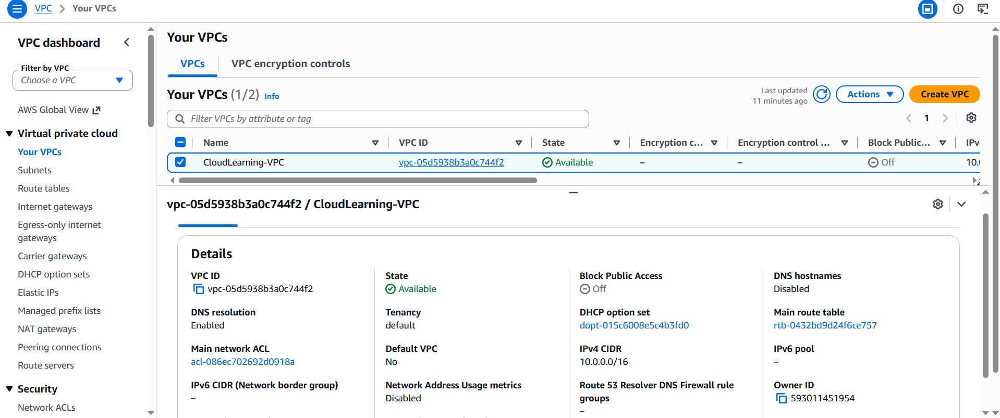
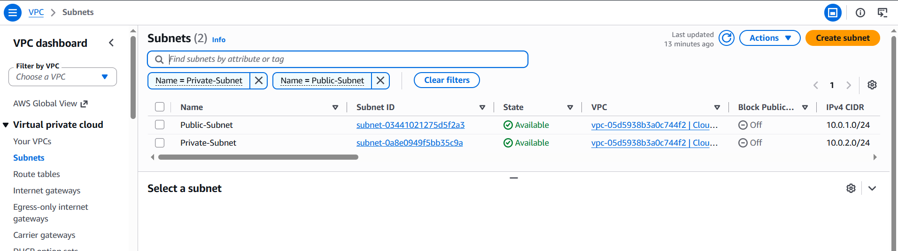
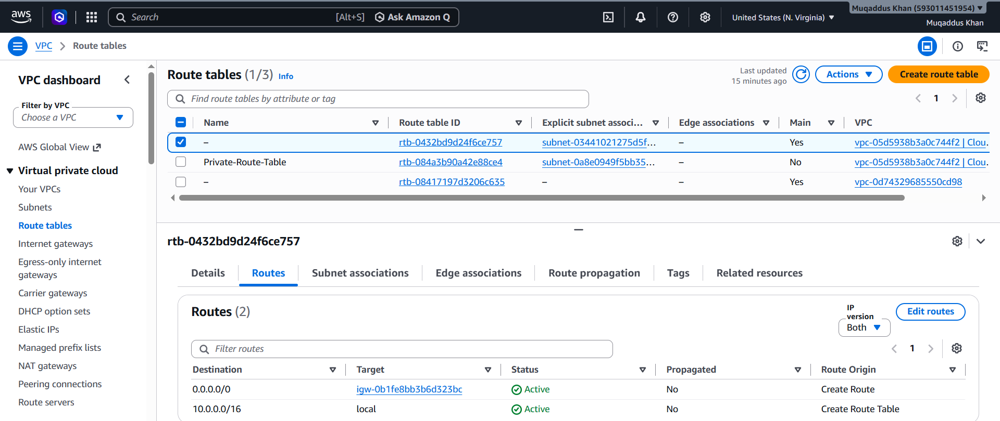

# aws-vpc-networking-project
Beginner AWS project demonstrating VPC networking, public and private subnets, route tables, and Internet Gateway configuration.
# AWS VPC Networking Project

## Project Overview

This beginner-friendly AWS project demonstrates how to create a Virtual Private Cloud (VPC) with separate public and private subnets, configure an Internet Gateway, and use route tables to control network traffic.

## AWS Services Used

- Amazon VPC
- Subnets
- Internet Gateway (IGW)
- Route Tables

## Network Architecture

**VPC CIDR:** `10.0.0.0/16`

| Resource | CIDR / Configuration |
|---|---|
| Public Subnet | `10.0.1.0/24` |
| Private Subnet | `10.0.2.0/24` |
| Internet Gateway | Attached to the VPC |
| Public Route | `0.0.0.0/0` → Internet Gateway |
| Private Route | `10.0.0.0/16` → local |

## What I Implemented

1. Created a custom VPC.
2. Created separate public and private subnets.
3. Created and attached an Internet Gateway.
4. Configured a route table for the public subnet.
5. Configured a separate route table for the private subnet.
6. Verified subnet associations and routing.

## Key Learnings

- Understanding VPCs and CIDR blocks.
- Difference between public and private subnets.
- How Internet Gateways and route tables work.
- Why separate route tables help control network connectivity.

## Security Considerations

The private subnet has no direct default route to the Internet Gateway. This does not by itself guarantee security; security groups, network ACLs, and resource configurations are also important.

## Cost Considerations

This project used basic VPC networking components. No EC2 instance or NAT Gateway was created as part of this project. Other AWS resources and network usage can incur charges, so billing should always be checked.

## Project Status

Completed — basic VPC networking configuration and route verification.
## Project Screenshots

### VPC Details

### Subnets

### Route Tables

